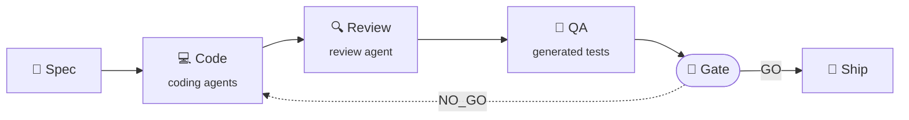

<!-- Header -->
<div align="center">

<picture>
  <source media="(prefers-color-scheme: dark)" srcset="https://capsule-render.vercel.app/api?type=waving&color=0:0D1117%2C45:1F6FEB%2C100:2DD4BF&height=220&section=header&text=Dat%20Vu&fontSize=72&fontColor=ffffff&fontAlignY=36&desc=Software%20Engineer%20%C2%B7%20Mobile%2FFlutter%20%C2%B7%20AI-Assisted%20Engineering&descSize=18&descAlignY=58&animation=fadeIn" />
  
</picture>

<a href="https://github.com/dab246">
<picture>
  <source media="(prefers-color-scheme: dark)" srcset="https://readme-typing-svg.demolab.com?font=JetBrains+Mono&weight=600&size=22&duration=3200&pause=900&center=true&vCenter=true&width=640&lines=Building+cross-platform+apps+with+Flutter+%26+Dart;Core+contributor+to+Twake+Mail+%40+Linagora;Open-source+author+of+Dart+%26+Flutter+packages;Building+AI+agents+that+automate+the+SDLC;Less+toil%2C+faster+releases%2C+same+quality+bar&color=2DD4BF" />
  
</picture>
</a>

<p>
  
  <a href="https://github.com/dab246?tab=followers"></a>
  <a href="https://github.com/linagora"></a>
  
</p>

</div>

## 👨🏻‍💻 About Me

```dart
class DatVu extends SoftwareEngineer {
  @override
  final String role = 'Software Engineer · Mobile & Flutter';
  final String company = 'Linagora';
  final String location = 'Ha Noi, Viet Nam 🇻🇳';

  final List<String> focus = [
    'Cross-platform apps: Android · iOS · Web (Flutter)',
    'Clean architecture, testing & release quality',
    'Protocols & networking: JMAP · DNS · IP',
    'AI agents that automate the software lifecycle',
  ];

  @override
  String get motto => 'Ship clean code. Measure. Automate the rest.';
}
```

- 🏆 <!-- ABOUT:START -->**#1 contributor** to **[Twake Mail](https://github.com/linagora/tmail-flutter)** (3.6k+ commits), an open-source, multi-platform email client on the JMAP protocol.<!-- ABOUT:END -->
- 📦 Maintaining Dart & Flutter packages on **pub.dev** ([see below](#-personal-projects)), from UI widgets to a DNS/IP networking stack.
- 🤖 Learning, researching and building **AI tools that automate the software lifecycle**, from spec to review, QA and release, to cut delivery time without lowering the quality bar ([more](#-ai-powered-engineering)).
- 🌱 Currently researching **multi-agent orchestration**, **MCP** integrations and **LLM evaluation & guardrails**.

## 🛠️ Tech Stack

<div align="center">

**Mobile & Cross-platform**

<picture>
  <source media="(prefers-color-scheme: dark)" srcset="https://skillicons.dev/icons?i=flutter%2Cdart%2Ckotlin%2Cjava%2Cswift%2Candroidstudio&theme=dark&perline=10" />
  
</picture>

**Web & Data**

<picture>
  <source media="(prefers-color-scheme: dark)" srcset="https://skillicons.dev/icons?i=ts%2Cjs%2Creact%2Chtml%2Ccss%2Csqlite&theme=dark&perline=10" />
  
</picture>

**DevOps & Tools**

<picture>
  <source media="(prefers-color-scheme: dark)" srcset="https://skillicons.dev/icons?i=git%2Cgithub%2Cgithubactions%2Cdocker%2Clinux%2Capple%2Cvscode%2Cvim%2Cpostman%2Cfigma&theme=dark&perline=10" />
  
</picture>

</div>

## 🧠 AI-Powered Engineering

> **Mission:** automate every repeatable step of software delivery with AI agents, so engineers spend their time on design and judgment, not on toil.
>
> **Principle:** *AI proposes, deterministic checks decide.* Every agent output is verified by tests, policies or a human before it ships.



### 🛠️ What I'm building

| Tool | What it automates |
| :--- | :--- |
| 🧪 [**qa-agent-kit**](https://github.com/dab246/qa-agent-kit) | Evidence-driven QA for pull requests: permission test matrices, a checksummed evidence registry and a **GO / NO_GO release gate**. AI drafts tests and triages failures; only validated results can pass the gate. |
| 🔍 **Branch review agent** | A Claude Code skill that reviews any MR/PR (GitHub, GitLab, Bitbucket) for architecture, correctness, performance, ReDoS, security and memory leaks, then posts line-anchored comments, fixes the branch or fills missing unit & e2e tests. |
| 📏 **Agent guardrails** | Shared engineering rules for coding agents: ReDoS checks measured on every regex engine, a content review before every push, consistent commits and review comments. |
| 🔄 **Self-updating profile** | This README: a GitHub Action ranks my projects and contributions from the GitHub and pub.dev APIs every day. |
| ✅ **AI quality gates in CI** | CodeRabbit and CodeScene on every PR, so humans review intent while machines catch smells and regressions. |

### 📚 Learning & research

- 🕸️ **Agentic workflows & multi-agent orchestration:** splitting delivery into planner, coder, reviewer and tester agents.
- 🔌 **Model Context Protocol (MCP):** connecting agents to issue trackers, repos, design files and CI.
- 📐 **Spec-driven development:** turning specs into tasks, code and tests an agent can verify.
- 🧮 **LLM evaluation & guardrails:** measuring agent output with deterministic checks instead of trust.
- 🧠 **Context engineering:** skills, memory and project rules that make agents reliable on large codebases.

## 🤖 AI Toolkit

<div align="center">

| Category | Tools |
| :--- | :--- |
| **Coding agents** | ![Claude Code][claude-code] ![Codex][codex] ![GitHub Copilot][copilot] |
| **Models** | ![Claude][claude] ![GPT][gpt] ![Gemini][gemini] |
| **AI code review** | ![CodeRabbit][coderabbit] ![CodeScene][codescene] |
| **Protocols & workflow** | ![MCP][mcp] ![Agent Skills][skills] ![GitHub Actions][gha] |

</div>

## 🌟 Open Source Highlights

<div align="center">

<!-- HIGHLIGHTS:START -->
<a href="https://github.com/linagora/tmail-flutter/graphs/contributors"></a>  <a href="https://github.com/search?q=author%3Adab246+is%3Apr+is%3Amerged+-user%3Adab246&type=pullrequests"></a>
<!-- HIGHLIGHTS:END -->

</div>

### 🏢 Core work at Linagora

<!-- ORG_PROJECTS:START -->
| Project | Description | Stars | My contribution |
| :--- | :--- | :---: | :--- |
| 📬 [**Twake Mail**](https://github.com/linagora/tmail-flutter) | Multi-platform JMAP email client for Android, iOS and Web | ⭐&nbsp;661 | **#1 contributor** · 3.6k+ commits · [1.1k+ merged PRs](https://github.com/linagora/tmail-flutter/pulls?q=is%3Apr+is%3Amerged+author%3Adab246) |
| 🔌 [**jmap-dart-client**](https://github.com/linagora/jmap-dart-client) | JMAP protocol client library in Dart, the foundation of Twake Mail | ⭐&nbsp;41 | **#1 contributor** · 101 commits · [48 merged PRs](https://github.com/linagora/jmap-dart-client/pulls?q=is%3Apr+is%3Amerged+author%3Adab246) |
| 📁 [**LinShare Mobile**](https://github.com/linagora/linshare-mobile-flutter-app) | Flutter mobile app for LinShare, an open-source secure file-sharing platform | ⭐&nbsp;17 | **#2 contributor** · 221 commits · [96 merged PRs](https://github.com/linagora/linshare-mobile-flutter-app/pulls?q=is%3Apr+is%3Amerged+author%3Adab246) |
| 📅 [**flutter-date-range-picker**](https://github.com/linagora/flutter-date-range-picker) | Cross-platform custom date range picker | ⭐&nbsp;11 | **#1 contributor** · 16 commits · [6 merged PRs](https://github.com/linagora/flutter-date-range-picker/pulls?q=is%3Apr+is%3Amerged+author%3Adab246) |
| ✍️ [**rich-text-composer**](https://github.com/linagora/rich-text-composer) | Unified rich text composer powering the mail composer | ⭐&nbsp;6 | **#2 contributor** · 21 commits · [10 merged PRs](https://github.com/linagora/rich-text-composer/pulls?q=is%3Apr+is%3Amerged+author%3Adab246) |
| 🖋️ [**html-editor-enhanced**](https://github.com/linagora/html-editor-enhanced) | WYSIWYG HTML editor for Flutter (Summernote + InAppWebView) | ⭐&nbsp;6 | [45 merged PRs](https://github.com/linagora/html-editor-enhanced/pulls?q=is%3Apr+is%3Amerged+author%3Adab246) |
| 🎨 [**linagora-design-flutter**](https://github.com/linagora/linagora-design-flutter) | Enterprise UI design language & Flutter component library | ⭐&nbsp;3 | **#1 contributor** · 76 commits · [24 merged PRs](https://github.com/linagora/linagora-design-flutter/pulls?q=is%3Apr+is%3Amerged+author%3Adab246) |
| 📝 [**enough_html_editor**](https://github.com/linagora/enough_html_editor) | API-based HTML editor for Flutter | ⭐&nbsp;2 | [21 merged PRs](https://github.com/linagora/enough_html_editor/pulls?q=is%3Apr+is%3Amerged+author%3Adab246) |
<!-- ORG_PROJECTS:END -->

### 🌍 Upstream contributions

<!-- UPSTREAM:START -->
| Project | Stars | Merged contributions |
| :--- | :---: | :--- |
| ⚙️ [**worker_manager**](https://github.com/dsrenesanse/worker_manager) | ⭐&nbsp;335 | [Update task completion progress in isolate](https://github.com/dsrenesanse/worker_manager/pull/58) |
| 🖋️ [**html-editor-enhanced**](https://github.com/tneotia/html-editor-enhanced) | ⭐&nbsp;297 | [Fix height when initText is null or empty](https://github.com/tneotia/html-editor-enhanced/pull/233) |
| 🌐 [**universal_html**](https://github.com/dint-dev/universal_html) | ⭐&nbsp;208 | [BroadcastChannel method not found when run on `dart.library.io`](https://github.com/dint-dev/universal_html/pull/97) |
| 📄 [**flutter_pdf_render**](https://github.com/espresso3389/flutter_pdf_render) <sub>archived</sub> | ⭐&nbsp;108 | [Listen for outside click trigger events in PDF Viewer](https://github.com/espresso3389/flutter_pdf_render/pull/148) · [Fix js instance memory leak when close PDFViewer](https://github.com/espresso3389/flutter_pdf_render/pull/147) · [Forked InteractiveViewer code to support `wheel-to-scroll`](https://github.com/espresso3389/flutter_pdf_render/pull/144) |
| 📝 [**languagetool_textfield**](https://github.com/solid-software/languagetool_textfield) | ⭐&nbsp;40 | [Add some properties (cursorColor, onTextChange, focusNode, onT…](https://github.com/solid-software/languagetool_textfield/pull/83) |
| 🔤 [**flutter_charset_detector**](https://github.com/amake/flutter_charset_detector) | ⭐&nbsp;20 | [Support charset detector for web](https://github.com/amake/flutter_charset_detector/pull/6) |
| 📝 [**enough_html_editor**](https://github.com/Enough-Software/enough_html_editor) | ⭐&nbsp;13 | [Fix on long gesture on android device](https://github.com/Enough-Software/enough_html_editor/pull/30) |
| 🧭 [**dns_client**](https://github.com/amondnet/dns_client) | ⭐&nbsp;10 | [Support dns lookup resource record by type](https://github.com/amondnet/dns_client/pull/9) |
<!-- UPSTREAM:END -->

## 📦 Personal Projects

### Dart & Flutter packages

<!-- PACKAGES:START -->
| Package | Description | Stars | pub.dev |
| :--- | :--- | :---: | :--- |
| 🏷️ [**super_tag_editor**](https://github.com/dab246/super_tag_editor) | Tag editor widget for Flutter | ⭐&nbsp;17 | [v1.1.0](https://pub.dev/packages/super_tag_editor) · 👍 43 · ⬇️ 3.7k/mo |
| 🌐 [**super_dns_client**](https://github.com/dab246/super_dns_client) | DNS-over-HTTPS (DoH) lookups with multiple resolvers | ⭐&nbsp;4 | [v0.3.11](https://pub.dev/packages/super_dns_client) · 👍 4 · ⬇️ 4.1k/mo |
| 🖼️ [**flutter_super_html_viewer**](https://github.com/dab246/flutter_super_html_viewer) | Cross-platform HTML viewer widget | ⭐&nbsp;2 | [v0.1.0](https://pub.dev/packages/flutter_super_html_viewer) · 👍 19 · ⬇️ 131/mo |
| ✂️ [**middle_ellipsis_text**](https://github.com/dab246/middle_ellipsis_text) | Middle-ellipsis text for filenames & URLs | ⭐&nbsp;2 | [v1.0.0](https://pub.dev/packages/middle_ellipsis_text) · 👍 3 · ⬇️ 2.7k/mo |
| 🧬 [**super_dns**](https://github.com/dab246/super_dns) | DNS protocol: query parsing, encoding and responses (IPv4/IPv6) | ⭐&nbsp;1 | [v0.1.1](https://pub.dev/packages/super_dns) · 👍 0 · ⬇️ 3.7k/mo |
| 📏 [**super_file_size**](https://github.com/dab246/super_file_size) | Human-readable file sizes from raw bytes | ⭐&nbsp;1 | [v1.0.0](https://pub.dev/packages/super_file_size) · 👍 1 · ⬇️ 7/mo |
| 🧱 [**super_raw**](https://github.com/dab246/super_raw) | Write, read and debug binary data efficiently | ⭐&nbsp;1 | [v0.1.0](https://pub.dev/packages/super_raw) · 👍 1 · ⬇️ 3.7k/mo |
| 📡 [**super_ip**](https://github.com/dab246/super_ip) | IP protocol stack: IPv4, IPv6, ICMP, TCP, UDP | ⭐&nbsp;1 | [v0.1.0](https://pub.dev/packages/super_ip) · 👍 0 · ⬇️ 3.7k/mo |
<!-- PACKAGES:END -->

### Apps & AI tools

<!-- APPS:START -->
| Project | Description | Stars | Stack |
| :--- | :--- | :---: | :--- |
| ⏱️ [**ChronoWork**](https://github.com/dab246/ChronoWork) · [live](https://dab246.github.io/ChronoWork/) | Work-hour logging, leave tracking & weekly performance reports | ⭐&nbsp;1 | TypeScript |
| 🔹 [**github-stars-radar**](https://github.com/dab246/github-stars-radar) · [live](https://dab246.github.io/github-stars-radar/) | Top-starred new GitHub repositories of the week, month and year: AI tools, AI agents, mobile, web and languag… | ⭐&nbsp;1 | JavaScript |
| 🧪 [**qa-agent-kit**](https://github.com/dab246/qa-agent-kit) | Evidence-driven PR QA: deterministic permission tests, evidence registry and a GO/NO\_GO release gate | ⭐&nbsp;0 | TypeScript |
| ♟️ [**ai-chess-master**](https://github.com/dab246/ai-chess-master) | Online Chinese chess (Xiangqi): Alpha-Beta search engine, Gemini-powered move analysis & hints, leaderboard | ⭐&nbsp;0 | React · Gemini |
<!-- APPS:END -->

<sub>🔄 Project tables are refreshed daily from GitHub and pub.dev, ranked by stars, then by contributions.</sub>

## 📊 GitHub Analytics

<div align="center">

<picture>
  <source media="(prefers-color-scheme: dark)" srcset="https://github-readme-stats.vercel.app/api?username=dab246&show_icons=true&include_all_commits=true&count_private=true&hide_border=false&border_radius=12&bg_color=161B22&border_color=30363D&title_color=58A6FF&icon_color=2DD4BF&text_color=E6EDF3&ring_color=58A6FF" />
  
</picture>
<picture>
  <source media="(prefers-color-scheme: dark)" srcset="https://github-readme-stats.vercel.app/api/top-langs/?username=dab246&layout=compact&langs_count=8&exclude_repo=dab246.github.io%2Cbattery-calculator%2Ctmail-refactoring-docs&hide=html%2Ccmake%2Cc%2B%2B%2Cruby&hide_border=false&border_radius=12&bg_color=161B22&border_color=30363D&title_color=58A6FF&icon_color=2DD4BF&text_color=E6EDF3&ring_color=58A6FF" />
  
</picture>

<picture>
  <source media="(prefers-color-scheme: dark)" srcset="https://streak-stats.demolab.com/?user=dab246&border_radius=12&background=161B22&border=30363D&stroke=30363D&ring=58A6FF&fire=2DD4BF&currStreakNum=E6EDF3&sideNums=E6EDF3&currStreakLabel=58A6FF&sideLabels=9198A1&dates=9198A1" />
  
</picture>

</div>

## 🐍 Contribution Snake

<div align="center">

<picture>
  <source media="(prefers-color-scheme: dark)" srcset="https://raw.githubusercontent.com/dab246/dab246/output/github-contribution-grid-snake-dark.svg" />
  
</picture>

</div>

## 📫 Connect with Me

<div align="center">

[](mailto:datx1995@gmail.com) [](https://dab246.github.io) [](https://github.com/dab246)

</div>

<picture>
  <source media="(prefers-color-scheme: dark)" srcset="https://capsule-render.vercel.app/api?type=waving&color=0:2DD4BF%2C55:1F6FEB%2C100:0D1117&height=120&section=footer" />
  
</picture>

<!-- AI toolkit badges -->
[claude-code]: https://img.shields.io/badge/Claude%20Code-D97757?style=for-the-badge&logo=claude&logoColor=white
[codex]: https://img.shields.io/badge/OpenAI%20Codex-6E56CF?style=for-the-badge&logo=data:image/svg%2bxml;base64,PHN2ZyBmaWxsPSJ3aGl0ZSIgcm9sZT0iaW1nIiB2aWV3Qm94PSIwIDAgMjQgMjQiIHhtbG5zPSJodHRwOi8vd3d3LnczLm9yZy8yMDAwL3N2ZyI+PHBhdGggZD0iTTIyLjI4MTkgOS44MjExYTUuOTg0NyA1Ljk4NDcgMCAwIDAtLjUxNTctNC45MTA4IDYuMDQ2MiA2LjA0NjIgMCAwIDAtNi41MDk4LTIuOUE2LjA2NTEgNi4wNjUxIDAgMCAwIDQuOTgwNyA0LjE4MThhNS45ODQ3IDUuOTg0NyAwIDAgMC0zLjk5NzcgMi45IDYuMDQ2MiA2LjA0NjIgMCAwIDAgLjc0MjcgNy4wOTY2IDUuOTggNS45OCAwIDAgMCAuNTExIDQuOTEwNyA2LjA1MSA2LjA1MSAwIDAgMCA2LjUxNDYgMi45MDAxQTUuOTg0NyA1Ljk4NDcgMCAwIDAgMTMuMjU5OSAyNGE2LjA1NTcgNi4wNTU3IDAgMCAwIDUuNzcxOC00LjIwNTggNS45ODk0IDUuOTg5NCAwIDAgMCAzLjk5NzctMi45MDAxIDYuMDU1NyA2LjA1NTcgMCAwIDAtLjc0NzUtNy4wNzI5em0tOS4wMjIgMTIuNjA4MWE0LjQ3NTUgNC40NzU1IDAgMCAxLTIuODc2NC0xLjA0MDhsLjE0MTktLjA4MDQgNC43NzgzLTIuNzU4MmEuNzk0OC43OTQ4IDAgMCAwIC4zOTI3LS42ODEzdi02LjczNjlsMi4wMiAxLjE2ODZhLjA3MS4wNzEgMCAwIDEgLjAzOC4wNTJ2NS41ODI2YTQuNTA0IDQuNTA0IDAgMCAxLTQuNDk0NSA0LjQ5NDR6bS05LjY2MDctNC4xMjU0YTQuNDcwOCA0LjQ3MDggMCAwIDEtLjUzNDYtMy4wMTM3bC4xNDIuMDg1MiA0Ljc4MyAyLjc1ODJhLjc3MTIuNzcxMiAwIDAgMCAuNzgwNiAwbDUuODQyOC0zLjM2ODV2Mi4zMzI0YS4wODA0LjA4MDQgMCAwIDEtLjAzMzIuMDYxNUw5Ljc0IDE5Ljk1MDJhNC40OTkyIDQuNDk5MiAwIDAgMS02LjE0MDgtMS42NDY0ek0yLjM0MDggNy44OTU2YTQuNDg1IDQuNDg1IDAgMCAxIDIuMzY1NS0xLjk3MjhWMTEuNmEuNzY2NC43NjY0IDAgMCAwIC4zODc5LjY3NjVsNS44MTQ0IDMuMzU0My0yLjAyMDEgMS4xNjg1YS4wNzU3LjA3NTcgMCAwIDEtLjA3MSAwbC00LjgzMDMtMi43ODY1QTQuNTA0IDQuNTA0IDAgMCAxIDIuMzQwOCA3Ljg3MnptMTYuNTk2MyAzLjg1NThMMTMuMTAzOCA4LjM2NCAxNS4xMTkyIDcuMmEuMDc1Ny4wNzU3IDAgMCAxIC4wNzEgMGw0LjgzMDMgMi43OTEzYTQuNDk0NCA0LjQ5NDQgMCAwIDEtLjY3NjUgOC4xMDQydi01LjY3NzJhLjc5Ljc5IDAgMCAwLS40MDctLjY2N3ptMi4wMTA3LTMuMDIzMWwtLjE0Mi0uMDg1Mi00Ljc3MzUtMi43ODE4YS43NzU5Ljc3NTkgMCAwIDAtLjc4NTQgMEw5LjQwOSA5LjIyOTdWNi44OTc0YS4wNjYyLjA2NjIgMCAwIDEgLjAyODQtLjA2MTVsNC44MzAzLTIuNzg2NmE0LjQ5OTIgNC40OTkyIDAgMCAxIDYuNjgwMiA0LjY2ek04LjMwNjUgMTIuODYzbC0yLjAyLTEuMTYzOGEuMDgwNC4wODA0IDAgMCAxLS4wMzgtLjA1NjdWNi4wNzQyYTQuNDk5MiA0LjQ5OTIgMCAwIDEgNy4zNzU3LTMuNDUzN2wtLjE0Mi4wODA1TDguNzA0IDUuNDU5YS43OTQ4Ljc5NDggMCAwIDAtLjM5MjcuNjgxM3ptMS4wOTc2LTIuMzY1NGwyLjYwMi0xLjQ5OTggMi42MDY5IDEuNDk5OHYyLjk5OTRsLTIuNTk3NCAxLjQ5OTctMi42MDY3LTEuNDk5N1oiLz48L3N2Zz4=
[copilot]: https://img.shields.io/badge/GitHub%20Copilot-8957E5?style=for-the-badge&logo=githubcopilot&logoColor=white
[claude]: https://img.shields.io/badge/Claude-C15F3C?style=for-the-badge&logo=anthropic&logoColor=white
[gpt]: https://img.shields.io/badge/GPT-10A37F?style=for-the-badge&logo=data:image/svg%2bxml;base64,PHN2ZyBmaWxsPSJ3aGl0ZSIgcm9sZT0iaW1nIiB2aWV3Qm94PSIwIDAgMjQgMjQiIHhtbG5zPSJodHRwOi8vd3d3LnczLm9yZy8yMDAwL3N2ZyI+PHBhdGggZD0iTTIyLjI4MTkgOS44MjExYTUuOTg0NyA1Ljk4NDcgMCAwIDAtLjUxNTctNC45MTA4IDYuMDQ2MiA2LjA0NjIgMCAwIDAtNi41MDk4LTIuOUE2LjA2NTEgNi4wNjUxIDAgMCAwIDQuOTgwNyA0LjE4MThhNS45ODQ3IDUuOTg0NyAwIDAgMC0zLjk5NzcgMi45IDYuMDQ2MiA2LjA0NjIgMCAwIDAgLjc0MjcgNy4wOTY2IDUuOTggNS45OCAwIDAgMCAuNTExIDQuOTEwNyA2LjA1MSA2LjA1MSAwIDAgMCA2LjUxNDYgMi45MDAxQTUuOTg0NyA1Ljk4NDcgMCAwIDAgMTMuMjU5OSAyNGE2LjA1NTcgNi4wNTU3IDAgMCAwIDUuNzcxOC00LjIwNTggNS45ODk0IDUuOTg5NCAwIDAgMCAzLjk5NzctMi45MDAxIDYuMDU1NyA2LjA1NTcgMCAwIDAtLjc0NzUtNy4wNzI5em0tOS4wMjIgMTIuNjA4MWE0LjQ3NTUgNC40NzU1IDAgMCAxLTIuODc2NC0xLjA0MDhsLjE0MTktLjA4MDQgNC43NzgzLTIuNzU4MmEuNzk0OC43OTQ4IDAgMCAwIC4zOTI3LS42ODEzdi02LjczNjlsMi4wMiAxLjE2ODZhLjA3MS4wNzEgMCAwIDEgLjAzOC4wNTJ2NS41ODI2YTQuNTA0IDQuNTA0IDAgMCAxLTQuNDk0NSA0LjQ5NDR6bS05LjY2MDctNC4xMjU0YTQuNDcwOCA0LjQ3MDggMCAwIDEtLjUzNDYtMy4wMTM3bC4xNDIuMDg1MiA0Ljc4MyAyLjc1ODJhLjc3MTIuNzcxMiAwIDAgMCAuNzgwNiAwbDUuODQyOC0zLjM2ODV2Mi4zMzI0YS4wODA0LjA4MDQgMCAwIDEtLjAzMzIuMDYxNUw5Ljc0IDE5Ljk1MDJhNC40OTkyIDQuNDk5MiAwIDAgMS02LjE0MDgtMS42NDY0ek0yLjM0MDggNy44OTU2YTQuNDg1IDQuNDg1IDAgMCAxIDIuMzY1NS0xLjk3MjhWMTEuNmEuNzY2NC43NjY0IDAgMCAwIC4zODc5LjY3NjVsNS44MTQ0IDMuMzU0My0yLjAyMDEgMS4xNjg1YS4wNzU3LjA3NTcgMCAwIDEtLjA3MSAwbC00LjgzMDMtMi43ODY1QTQuNTA0IDQuNTA0IDAgMCAxIDIuMzQwOCA3Ljg3MnptMTYuNTk2MyAzLjg1NThMMTMuMTAzOCA4LjM2NCAxNS4xMTkyIDcuMmEuMDc1Ny4wNzU3IDAgMCAxIC4wNzEgMGw0LjgzMDMgMi43OTEzYTQuNDk0NCA0LjQ5NDQgMCAwIDEtLjY3NjUgOC4xMDQydi01LjY3NzJhLjc5Ljc5IDAgMCAwLS40MDctLjY2N3ptMi4wMTA3LTMuMDIzMWwtLjE0Mi0uMDg1Mi00Ljc3MzUtMi43ODE4YS43NzU5Ljc3NTkgMCAwIDAtLjc4NTQgMEw5LjQwOSA5LjIyOTdWNi44OTc0YS4wNjYyLjA2NjIgMCAwIDEgLjAyODQtLjA2MTVsNC44MzAzLTIuNzg2NmE0LjQ5OTIgNC40OTkyIDAgMCAxIDYuNjgwMiA0LjY2ek04LjMwNjUgMTIuODYzbC0yLjAyLTEuMTYzOGEuMDgwNC4wODA0IDAgMCAxLS4wMzgtLjA1NjdWNi4wNzQyYTQuNDk5MiA0LjQ5OTIgMCAwIDEgNy4zNzU3LTMuNDUzN2wtLjE0Mi4wODA1TDguNzA0IDUuNDU5YS43OTQ4Ljc5NDggMCAwIDAtLjM5MjcuNjgxM3ptMS4wOTc2LTIuMzY1NGwyLjYwMi0xLjQ5OTggMi42MDY5IDEuNDk5OHYyLjk5OTRsLTIuNTk3NCAxLjQ5OTctMi42MDY3LTEuNDk5N1oiLz48L3N2Zz4=
[gemini]: https://img.shields.io/badge/Gemini-8E75B2?style=for-the-badge&logo=googlegemini&logoColor=white
[coderabbit]: https://img.shields.io/badge/CodeRabbit-FF570A?style=for-the-badge&logo=coderabbit&logoColor=white
[codescene]: https://img.shields.io/badge/CodeScene-3A6FD8?style=for-the-badge
[mcp]: https://img.shields.io/badge/MCP-57606A?style=for-the-badge&logo=modelcontextprotocol&logoColor=white
[skills]: https://img.shields.io/badge/Agent%20Skills-B45309?style=for-the-badge&logo=claude&logoColor=white
[gha]: https://img.shields.io/badge/GitHub%20Actions-2088FF?style=for-the-badge&logo=githubactions&logoColor=white
